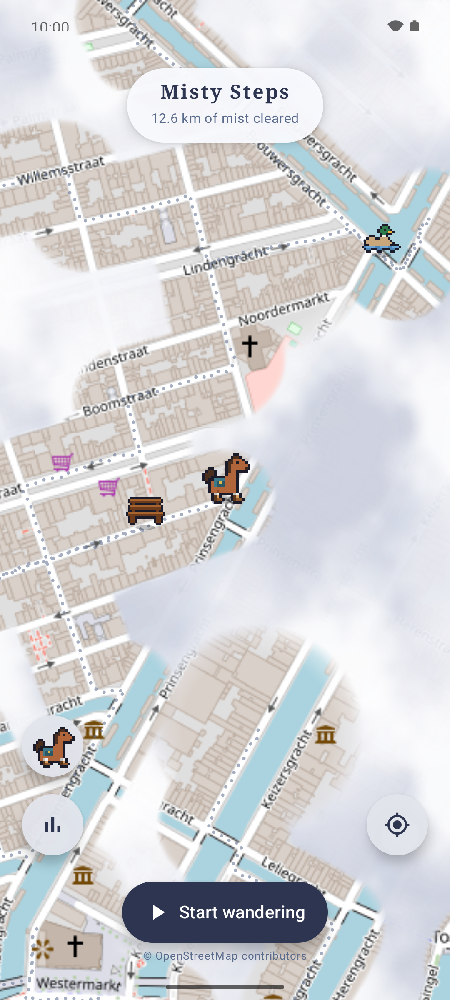
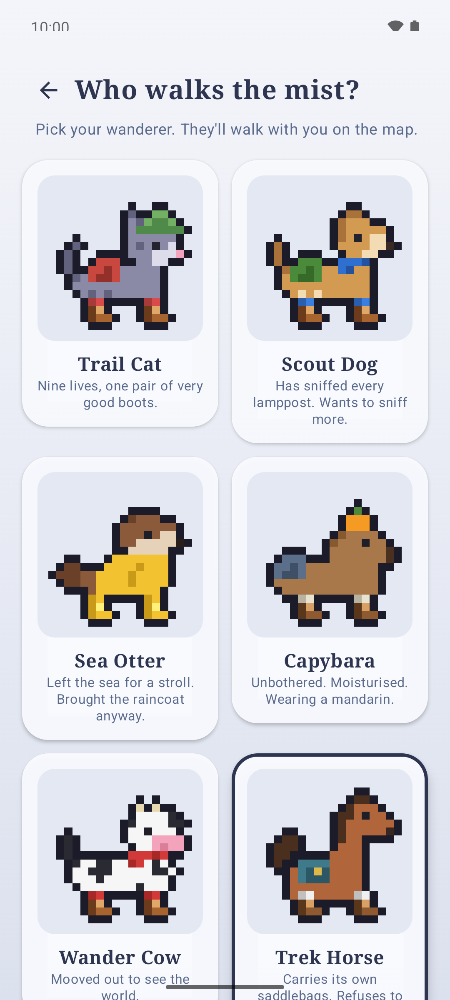
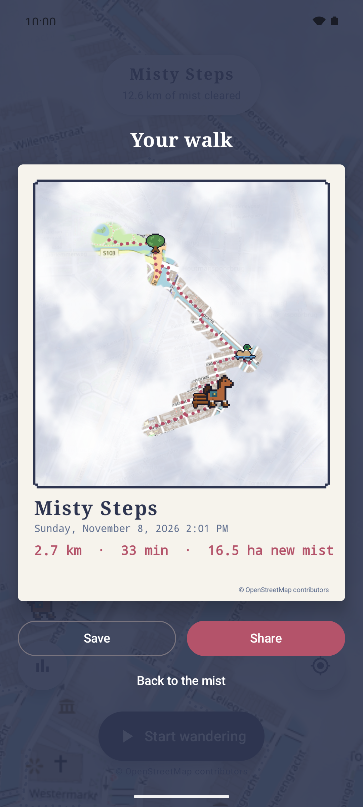

# Misty Steps

An Android app that covers the whole OpenStreetMap world in drifting fog. The only way to clear it
is to go outside: wherever you walk, cycle or roll with recording on, the fog lifts in a 50 m circle
around you. A pixel-art animal in hiking boots walks along. No ads, no accounts, no tracking: your
trails stay on your phone.

  

## Install

Add the Potloodgum F-Droid repo: open **https://fdroid.potloodgum.com** on your phone and tap
"Add to F-Droid" (works with F-Droid and Droid-ify), or download the APK from the same page.

## Feedback

Use "Send feedback" in the app (it emails debug@potloodgum.com), or open an
[issue](https://github.com/tjerk-git/misty-steps/issues).

## Build

Requires JDK 17 and the Android SDK (compileSdk 36).

```sh
./gradlew assembleDebug      # "Misty Steps Dev": app/build/outputs/apk/debug/app-debug.apk
./gradlew installDebug       # onto a connected device
./gradlew testDebugUnitTest
```

## How it works

| Piece | File |
|---|---|
| Map (osmdroid, OSM Mapnik tiles) | `ui/MapController.kt` |
| Fog renderer (osmdroid `Overlay`) | `fog/FogOverlay.kt`, `fog/FogTexture.kt` |
| GPS recording (foreground service, screen-off OK) | `record/RecordingService.kt` |
| Trail and walk storage (SQLite, local only) + spatial index | `data/FogStore.kt`, `data/TrailDatabase.kt`, `data/PointIndex.kt` |
| Trail line left behind on each walk | `trail/TrailOverlay.kt`, `data/Trails.kt` |
| Neighbourhood %, street completion (OSM Overpass, by area id) | `stats/Neighbourhoods.kt`, `stats/StreetCoverage.kt` |
| Walk postcards (save / share) | `postcard/PostcardRenderer.kt`, `ui/PostcardScreen.kt` |
| Mist colour through the day, pause at vehicle speed | `fog/MistPalette.kt`, `record/SpeedGate.kt` |
| Battery logging for test runs (debug builds only) | `debug/BatteryLog.kt`, project folder `debug/` |
| UI (Compose) | `ui/MistyScreen.kt` |

- **Recording:** GPS fixes with accuracy worse than 35 m are dropped. A spot is stored every 10 m or more;
  gaps up to 300 m are filled every 20 m so the trail has no holes. Bigger jumps (lost signal, a train)
  are not filled.
- **Fog:** drawn at half resolution into an offscreen bitmap: an even white layer plus two tiling noise
  layers that drift slowly. Each stored spot cuts out a soft 50 m circle. The cut-out mask is only rebuilt
  when the view or the trail changes. When zoomed out, spots never shrink below a visible speck, so you
  can still find your trails on the world map.
- **Stats:** cleared area is counted on ~10 x 10 m cells. City and country borders come from
  OpenStreetMap's Nominatim service, fetched once per area and kept on the phone.
- **Privacy:** no account and no server. Backup and device transfer are switched off, so the trail
  database never leaves the phone. Network traffic: map tiles from openstreetmap.org, and for the stats
  page a border lookup at Nominatim that sends only your position rounded to ~1 km, and neighbourhood and
  street lookups at Overpass that send only OpenStreetMap area ids (your city, your neighbourhood).

Note: the public OSM tile servers are for light use only
([tile usage policy](https://operations.osmfoundation.org/policies/tiles/)). If many people will use
the app, switch `TileSourceFactory.MAPNIK` to your own or a commercial tile provider.

## License and publishing

Misty Steps is made by [Potloodgum](https://potloodgum.com) and licensed under the GNU General Public License v3.0 (see `LICENSE`).
It's published in the Potloodgum F-Droid repo at https://fdroid.potloodgum.com (see `tools/publish.sh` and the
"Publishing" section of `workflow.md`).
